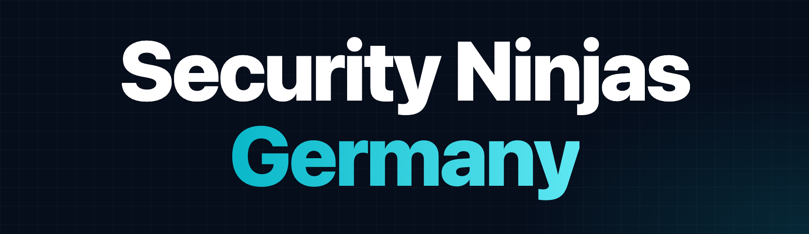

  

# Security Ninjas Germany - Slides Archive

The official slides archive for [Security Ninjas Germany](https://www.secninjas-germany.com), Germany's Microsoft security community conference.

Security Ninjas Germany is a community-driven, vendor-neutral conference for everyone defending the modern workplace. Security engineers, architects and SOC analysts share practical, real-world knowledge about identity, endpoint, cloud and security operations across the Microsoft security stack.

Part of the global Workplace Ninja community. By the community, for the community.

## 2026 Edition - Munich

- **Date:** October 20, 2026
- **Location:** Microsoft Germany HQ, Munich
- **Attendees:** 200
- **Speakers:** 25
- **Sessions:** 20
- **Tracks:** 2 (Hive, Washington)
- **Language:** English
- **Agenda:** [secninjas-germany.com/agenda](https://www.secninjas-germany.com/agenda)

### Session Slides

| Session | Speaker(s) |
|---|---|
| [Beyond No Return - Preparing Your Organization for Cyber War](2026/Beyond%20No%20Return%20-%20Preparing%20Your%20Organization%20for%20Cyber%20War%20-%20Miska%20Kyt%C3%B6.pdf) | Miska Kytö |
| [Beyond Secrets - Securing Workload Identities in Entra ID](2026/Beyond%20Secrets%20-%20Securing%20Workload%20Identities%20in%20Entra%20ID%20-%20Daniel%20Fraubaum.pdf) | Daniel Fraubaum |
| [Hidden gems in and around Defender XDR with Defender Boys](2026/Hidden%20gems%20in%20and%20around%20Defender%20XDR%20with%20Defender%20Boys%20-%20Stefan%20Sch%C3%B6rling%2C%20Mattias%20Borg.pdf) | Stefan Schörling, Mattias Borg |
| [Incident investigations and threat hunting with Microsoft Sentinel Graph](2026/Incident%20investigations%20and%20threat%20hunting%20with%20Microsoft%20Sentinel%20Graph%20-%20Uros%20Babic.pdf) | Uros Babic |
| [Normalize Once, Detect Everywhere - Inside Microsoft Sentinel's ASIM](2026/Normalize%20Once%2C%20Detect%20Everywhere%20-%20Inside%20Microsoft%20Sentinel%27s%20ASIM%20-%20Jannis%20Langthaler%2C%20Marvin%20Rose.pdf) | Jannis Langthaler, Marvin Rose |
| [Project Perception - From Red to Green with a lot of Blue in the middle](2026/Project%20Perception%20-%20From%20Red%20to%20Green%20with%20a%20lot%20of%20Blue%20in%20the%20middle%20-%20Jaime%20Guimera%20Coll.pdf) | Jaime Guimera Coll |
| [The Modern SecOps Playbook - Microsoft Sentinel Data Lake, Graphs, and Agentic Tools](2026/The%20Modern%20SecOps%20Playbook%20-%20Microsoft%20Sentinel%20Data%20Lake%2C%20Graphs%2C%20and%20Agentic%20Tools%20-%20Sami%20Lamppu.pdf) | Sami Lamppu |
| [You've got Detection Rules but will they spot a real attacker](2026/You%27ve%20got%20Detection%20Rules%20but%20will%20they%20spot%20a%20real%20attacker%20-%20Jay%20Kerai%2C%20Effie%20Antoniadi.pdf) | Jay Kerai, Effie Antoniadi |

### Topics

- Microsoft Sentinel & Security Operations
- Microsoft Defender XDR & Threat Hunting
- Identity Security & Microsoft Entra
- Workload Identities & Privileged Access
- Azure & Cloud Security
- AI & Agentic Security

## Organizers

- Alexander Benoit
- Christian Lehrer
- Christopher Brumm
- Fabian Bader
- Kyle Frieler
- Roman Kleyn
- Ugur Koc
